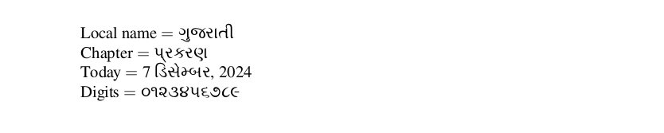

# Gujarati

<blockquote>
  <p><em>Improve this page! Feel free to draft a pull request <a href="https://github.com/latex3/babel/tree/docs/docs">on GitHub</a>.<br>
  <a href="https://www.google.com/search?q=site%3Alatex3.github.io%2Fbabel+Gujarati">Search this site for more on Gujarati</a>.</em></p>
</blockquote>

This page offers basic guidance on typesetting a LaTeX document in the
Gujarati language using the Gujarati script.

## Support with `ini` locale file

Here is a minimal sample file with `gujarati` as the main language
(assuming `luatex`, which is the recommended engine, and `babel` ≥25.14,
although it may work with previous versions).

```tex
\documentclass[gujarati]{article}

\usepackage{babel}

\babelfont{rm}{FreeSerif}

\begin{document}

Local name $=$ ગુજરાતી

Chapter $=$ \chaptername

Today $=$ \today

Digits $=$ \localenumeral{digits}{0123456789}

\end{document}
```



## Counters

Although Gujarati numerals are best entered directly in its original
form, you may still need some conversion because LaTeX uses internally
the Arabic ones. With `luatex` there are two ways to map Arabic to
Gujarati numerals, passed as option to `\babelprovide`:
* `maparabic` does it at the TeX level, by redefining `\arabic`. Note
  the form written to the auxiliary files is the converted one (which
  can be an issue in indexes). It works with `xetex`, too.
* `mapdigits` does it at the engine level. This is
  usually the preferred method.
  
To perform this conversión, use the following preamble:
```tex
\usepackage[gujarati, provide=mapdigits]{babel} % or alternatively maparabic
\babelfont{rm}{FreeSerif}
```

See the explanation in the babel manual about `\localecounter` and
`localenumeral`.

## Punctuation

_Only luatex_. The transform `danda.nobreak` prevents a line break
before a danda or double danda if there is a space.

In Unicode, danda and double danda are shared by several scripts, and
`babel` doesn’t assign them by default to any of them. If you are using
`onchar` to select the font you may want to assign them with:
```tex
\babelcharproperty{`।}{locale}{bangla}
\babelcharproperty{`॥}{locale}{bangla}
```

## Contribute

If you are a native speaker or have expertise in this language, you can
contribute, make suggestion or request an enhancement by submitting a
pull request, opening an issue, or contacting the Babel maintainer with
the link above.